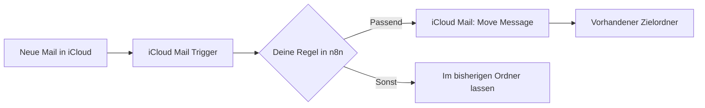
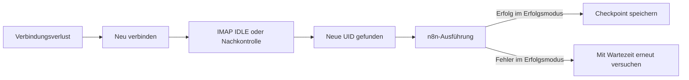

# iCloud Mail für n8n

E-Mails aus iCloud lesen, nach passenden Nachrichten suchen, in vorhandene Ordner verschieben und Workflows bei neuen Nachrichten starten.

**Zwei Nodes · IMAP über TLS · keine zusätzlichen Laufzeit-Abhängigkeiten · MIT**

Dieses Projekt ist ein unabhängiger, unverifizierter Community-Node für selbst gehostetes n8n. Es ist kein offizielles Produkt von Apple oder n8n. Der Node enthält keine KI und sendet Mailinhalte nicht an einen KI-Dienst.



## Was ist enthalten?

| Node | Funktion | Typisches Beispiel |
| --- | --- | --- |
| **iCloud Mail** | List Mailboxes | Exakte Ordnerpfade abrufen |
| **iCloud Mail** | Get Many Messages | Ungelesene Mails oder einen bestimmten Absender suchen |
| **iCloud Mail** | Get Message | Eine Nachricht mit ihrer UID vollständig lesen |
| **iCloud Mail** | Move Message | Eine Nachricht nach einer eigenen Regel verschieben |
| **iCloud Mail Trigger** | Neue Nachrichten erkennen | Workflow bei einem Eingang starten; Wiederverbindung und Nachkontrolle inklusive |

Unterstützt werden alle äußeren Nachrichtenheader, Text und HTML, Anhangsmetadaten und optional heruntergeladene Anhänge. Lesen verändert standardmäßig nicht den Gelesen-Status. Ordner anlegen, Mails versenden und Flags setzen oder entfernen sind keine angebotenen Operationen.

## Voraussetzungen

- Selbst gehostetes n8n mit Unterstützung für unverifizierte Community-Nodes.
- Node.js ab 22; für Entwicklung und CI wird Node.js 24 verwendet. Die Anforderungen der eingesetzten n8n-Version gelten zusätzlich.
- iCloud Mail und ein [app-spezifisches Passwort](https://support.apple.com/en-us/102654).
- Ausgehende TLS-Verbindungen zu `imap.mail.me.com:993`. Host, Port und TLS sind im Node festgelegt.

Das Paket wird gegen `n8n-workflow` 2.16.0 gebaut. Die Tests verwenden lokale IMAP-Testserver; sie ersetzen keinen Integrationstest mit der eigenen n8n-Instanz und iCloud.

## Installation

### Über npm / Community Nodes

Der npm-Paketname lautet **`n8n-nodes-icloud-imap`**. Der GitHub-Repositoryname ist davon unabhängig. Ein GitHub-Commit veröffentlicht noch kein npm-Paket.

Sobald eine Version auf npm freigegeben ist:

1. In n8n als Owner oder Admin **Settings → Community Nodes → Install** öffnen.
2. `n8n-nodes-icloud-imap` oder eine konkrete veröffentlichte Version wie `n8n-nodes-icloud-imap@0.3.3` eintragen.
3. Den Hinweis zu unverifiziertem Code bestätigen und installieren.
4. Einen Node **iCloud Mail** oder **iCloud Mail Trigger** zum Workflow hinzufügen.

Updates werden ebenfalls über **Settings → Community Nodes** verwaltet. [n8n-Installationsanleitung](https://docs.n8n.io/integrations/community-nodes/installation-and-management/gui-installation/)

### Als Custom-Node ohne npm-Installation auf dem Server

Nach dem lokalen Build mit `pnpm run build:custom` liegt die fertige Runtime unter `artifacts/custom-<Version>/icloud-imap/`. Diesen Ordner in das n8n-Custom-Verzeichnis kopieren, im üblichen Docker-Setup nach `/home/node/.n8n/custom/icloud-imap/`, und n8n neu starten. Der laufende n8n-Benutzer braucht Lesezugriff. Das Host-Verzeichnis hängt vom eigenen Volume-Mount ab.

Nicht gleichzeitig die Custom- und die npm-Variante laden: Beide registrieren denselben Credential-Typ. Das installierte Paket braucht keine zusätzlichen Laufzeitbibliotheken.

## In wenigen Minuten zum ersten Workflow

### 1. Zugangsdaten hinterlegen

Eine Credential vom Typ **iCloud Mail IMAP** anlegen:

| Feld | Wert |
| --- | --- |
| IMAP Username | iCloud-Mail-Benutzername; falls erforderlich die vollständige Adresse |
| App-Specific Password | Das bei Apple erzeugte app-spezifische Passwort |

Der Node verwendet TLS mit Zertifikatsprüfung. Passwörter gehören ausschließlich in n8n-Credentials, nicht in Workflow-Code, Beispieldateien oder GitHub. [Apple-IMAP-Einstellungen](https://support.apple.com/en-us/102525)

### 2. Erst lesen

**Manual Trigger → iCloud Mail** verbinden, **Get Many Messages** wählen, Mailbox auf `INBOX` und Limit auf `5` setzen. **Headers Only** liefert Header und Metadaten, ohne Text und Anhänge herunterzuladen. **List Mailboxes** zeigt die tatsächlichen Serverpfade der eigenen Ordner.

### 3. Neue Mails verarbeiten

Im **iCloud Mail Trigger** Credential und Ordner wählen. Für einen manuellen Test **Listen for test event** starten und erst danach eine neue Mail senden. Für den Dauerbetrieb den Workflow veröffentlichen. Ein manueller Listener ist eine separate Testverbindung; nicht parallel zum produktiven Listener testen, wenn doppelte Verarbeitung vermieden werden soll.

### 4. Gezielt verschieben

Nach dem Trigger kann ein IF- oder Switch-Node eine eigene Regel prüfen. Der nachgeschaltete **iCloud Mail → Move Message** benötigt:

| Feld | Expression / Auswahl |
| --- | --- |
| Mailbox Name or ID | `{{ $json.mailbox }}` |
| Message UID | `{{ $json.uid }}` |
| Source UIDVALIDITY | `{{ $json.uidValidity }}` |
| Destination Mailbox Name or ID | Einen vorhandenen Zielordner auswählen |

Diese Expressions gelten, solange die vorherigen Schritte die Mailfelder weiterreichen. UID und UIDVALIDITY müssen aus derselben Nachricht stammen. Bei einer geänderten UIDVALIDITY bricht die Verschiebung ab, damit eine wiederverwendete UID nicht die falsche Mail trifft.

Eine Verschiebung verwendet `UID MOVE` oder, mit UIDPLUS, `UID COPY` und ein auf die betroffene UID begrenztes Löschen. Ohne passende Serverunterstützung wird sie abgelehnt. Es werden keine Ordner automatisch erstellt. Nach einem Verbindungsabbruch während eines Moves zuerst Quelle und Ziel prüfen: Der Server könnte ihn bereits ausgeführt haben. Moves werden nicht automatisch wiederholt.

## Ausgabe und Grenzen

Die Ausgabe enthält unter anderem `uid`, `uidValidity`, `mailbox`, `messageKey`, `subject`, Adressen, Datum und Flags. Vollständig gelesene Nachrichten enthalten zusätzlich Text/HTML; heruntergeladene Anhänge stehen in n8n-Binärfeldern wie `attachment_0`.

Alle äußeren Mailheader stehen unter `headers`, mit kleingeschriebenen Namen und Listen als Werten. Beispiel für den ersten List-Unsubscribe-Header:

```javascript
{{ $json.headers?.['list-unsubscribe']?.[0] ?? '' }}
```

Header angehängter Nachrichten oder einzelner MIME-Teile sind darin nicht enthalten. HTML ist unverändert und muss vor einer eigenen Webdarstellung bereinigt werden.

| Einstellung | Verhalten |
| --- | --- |
| Get Many: Limit | Standard 50, maximal 1.000 Treffer pro Eingangselement; neueste zuerst, keine Pagination |
| Get Many: Filters | Ungelesen, Absender, Empfänger, Betreff, Text und Empfangsdatum; IMAP-Datumsfilter sind tagesgenau |
| Headers Only | Alle äußeren Header und Metadaten; kein Mailtext und keine Anhangsdateien |
| Max Message Size | Standard 25 MB, einstellbar 1–100 MB; größere Mails liefern Metadaten mit `bodySkipped: true` |
| Mark as Read | Bei Lese-Aktionen optional, standardmäßig aus |

Leere Ordner liefern bei Get Many keine Items. Bei fehlender SEARCH-Antwort gibt es einen begrenzten Ersatzweg; eine fehlgeschlagene gefilterte Suche wird nicht als erfolgreiches ungefiltertes Ergebnis ausgegeben.

Der MIME-Parser hat Größen-, Teile- und Verschachtelungsgrenzen. Im Trigger werden erkannte Parserprobleme als `parseError` mit Metadaten ausgegeben; solche Mails im Workflow gesondert behandeln. IMAP- und Speicherfehler bleiben Fehler. Der Parser ist keine vollständige Implementierung aller historischen MIME-Sonderfälle.

## Trigger, Wiederverbindung und Nacharbeiten



| Option | Standard / Bedeutung |
| --- | --- |
| Catch-Up Interval | 60 Sekunden; regelmäßige Suche zusätzlich zu IMAP IDLE |
| Batch Size | 50 Mails pro Nachholabfrage; jede Mail startet eine eigene Ausführung |
| Include Existing Messages on First Activation | Aus; kann beim ersten produktiven Start vorhandene Mails einbeziehen |
| Resume After Successful Workflow | Aus; bei Aktivierung wird eine Mail nach der anderen verarbeitet und erst nach Erfolg bestätigt |
| Catch Up From | Optionale Startgrenze für den Erfolgsmodus, sofern noch kein Checkpoint vorhanden ist |
| Retry Failed Workflow After | Anfangs 30 Sekunden; steigt bei wiederholten Workflow-Fehlern bis auf fünf Minuten |
| Include Trigger Diagnostics | Aus; ergänzt technische Listener-Daten zur Fehlersuche |

Nach Verbindungsverlust verbindet sich der Trigger mit ansteigender Wartezeit von 1 bis 60 Sekunden neu. Nachgearbeitet werden Nachrichten, die noch im überwachten Ordner verfügbar sind. Eine neu in diesen Ordner verschobene Mail kann ebenfalls einen Eingang auslösen.

### Wo wird der Fortschritt gespeichert?

- **Standardmodus:** n8n-Workflow-Static-Data halten Konto, Ordner, UIDVALIDITY und die zuletzt ausgegebene UID. Dieser Modus bestätigt die Übergabe, nicht den späteren Geschäftserfolg.
- **Erfolgsmodus:** Separate Checkpoint-Dateien halten UIDVALIDITY, letzte erfolgreich verarbeitete UID und gegebenenfalls eine Startgrenze oder gesperrte UID. Keine Mailtexte oder Passwörter. Der Dateiname ist ein Hash aus Workflow-ID, Node-ID, Konto und Ordner.

Standardverzeichnis bei einem üblichen n8n-Docker-Container:

```text
/home/node/.n8n/icloud-imap-checkpoints
```

Im Code gilt `N8N_USER_FOLDER` oder das Home-Verzeichnis als Basis; darunter wird `.n8n/icloud-imap-checkpoints` verwendet. Ein explizites persistentes Verzeichnis lässt sich setzen:

```yaml
environment:
  ICLOUD_IMAP_CHECKPOINT_DIR: /home/node/.n8n/icloud-imap-checkpoints
```

Das Verzeichnis muss auf einem persistenten Volume liegen und für den laufenden n8n-Benutzer beschreibbar sein. Es gehört in die eigene Datensicherung. Insbesondere bei einem anderen Containerbenutzer den Pfad ausdrücklich setzen. Nicht in das installierte npm-Paket schreiben.

Eine ungeklärte Ausführung oder geänderte UIDVALIDITY stoppt im Erfolgsmodus die Verarbeitung zur Prüfung. Checkpoints nicht blind löschen: Bereits ausgeführte Aktionen könnten sonst wiederholt werden. Wiederholungen nach Fehlern verlangen idempotente nachgelagerte Aktionen. Es gibt keine Exactly-once-Garantie und keinen verteilten Lock über mehrere n8n-Prozesse. Eine neue Workflow-ID oder Trigger-ID erzeugt einen eigenen Erfolgsstand.

Direkter Datei- und Umgebungsvariablenzugriff ist mit den n8n-Anforderungen an **verifizierte** Community-Nodes nicht vereinbar. Dieses Paket ist ausdrücklich für den unverifizierten, selbst gehosteten Einsatz vorgesehen.

## Von einer Custom-Installation zum npm-Paket wechseln

1. Workflows und n8n-Daten einschließlich Checkpoints sichern; betroffene Workflows deaktivieren und Ausführungen abwarten.
2. Die Custom-Runtime außerhalb des Custom-Ladeverzeichnisses sichern und n8n neu starten.
3. Die gewünschte veröffentlichte npm-Version installieren.
4. Im bestehenden Workflow nur die betroffenen Node-Typen umstellen:

| Custom | npm |
| --- | --- |
| `CUSTOM.iCloudMail` | `n8n-nodes-icloud-imap.iCloudMail` |
| `CUSTOM.iCloudMailTrigger` | `n8n-nodes-icloud-imap.iCloudMailTrigger` |

5. Workflow-ID, Trigger-ID, Konto, Quellordner und Checkpoint-Verzeichnis erhalten, wenn der bisherige Erfolgsstand weitergenutzt werden soll.
6. Credential-Zuordnung und Expressions prüfen; anschließend kontrolliert aktivieren. Nur einen produktiven Listener für dieselbe Verarbeitung betreiben.

## Entwicklung und Tests

```sh
npm install --global pnpm@11.25.0 --ignore-scripts
pnpm install --frozen-lockfile --ignore-scripts
pnpm run check
pnpm run test:package
pnpm run build:custom
pnpm pack --pack-destination artifacts/npm
```

Die Tests benötigen lokale Loopback-Verbindungen und OpenSSL. Sie erzeugen pro Testprozess ein kurzlebiges Zertifikat samt Schlüssel, lesen beide in den Arbeitsspeicher und entfernen die temporären Dateien sofort wieder. Es werden keine Schlüsseldateien mitgeliefert. Auf Windows kann `ICLOUD_TEST_OPENSSL` auf die eigene `openssl.exe` zeigen, etwa aus Git for Windows. Die npm-Dateiauswahl schließt Tests, Quellcode und lokale Arbeitsdateien aus.

| Verzeichnis | Inhalt |
| --- | --- |
| `nodes/`, `credentials/` | TypeScript-Quellcode, Node-Metadaten und Icon |
| `test/` | Tests für Protokoll, Parser, Wiederverbindung, Checkpoints und Mehrfachauslösung |
| `examples/` | Drei allgemeine Beispiele ohne Credential-Referenzen; Move-Nodes sind zunächst deaktiviert |
| `scripts/` | Build, Paketprüfung und optionaler Custom-Build |
| `.github/workflows/` | CI und ausdrücklich angeforderte npm-Vormerkung |

Die Beispiele im npm-Tarball unter `dist/examples/` verwenden die npm-Typnamen. Die Quellbeispiele unter `examples/` verwenden die Custom-Typnamen. Vor Veröffentlichung eigener Workflows die Credentials auswählen und Zielordner anpassen.

## GitHub → npm

Der Workflow **Build and stage npm package** baut und testet bei Pushes und Pull Requests. Er erstellt ein geprüftes npm-Tarball als Actions-Artefakt. Ein normaler Push veröffentlicht nichts auf npm.

1. Den ersten erfolgreichen Build in **Actions** öffnen und `n8n-community-package` herunterladen.
2. Für die erste npm-Freigabe das entpackte `.tgz` mit dem eigenen npm-Konto veröffentlichen. Vorher Paketname, Dateiliste und Versionsnummer prüfen.
3. Für spätere Versionen bei npm unter **Trusted Publishers** das Repository `mximum/n8n-node-icloud-imap`, die Workflow-Datei `publish.yml` und die GitHub-Umgebung `npm-publish` eintragen; Vormerken mit `npm stage publish` zulassen.
4. In GitHub die Umgebung `npm-publish` anlegen. Die Versionsnummer in `package.json` für jede Veröffentlichung erhöhen.
5. **Actions → Run workflow** auf `main` starten und `stage_release` aktivieren.
6. Die vorgemerkte Version bei npm prüfen und freigeben. Erst dann wird sie öffentlich installierbar.

GitHub verwendet dafür OIDC mit kurzlebigen Anmeldedaten; ein dauerhaftes npm-Token ist nicht vorgesehen. Repository- und npm-Metadaten bleiben öffentlich. [npm Trusted Publishing](https://docs.npmjs.com/trusted-publishers/)

## Lizenz

[MIT](LICENSE). iCloud ist eine Marke von Apple Inc. Dieses Projekt ist unabhängig und wird weder von Apple noch von n8n herausgegeben.
